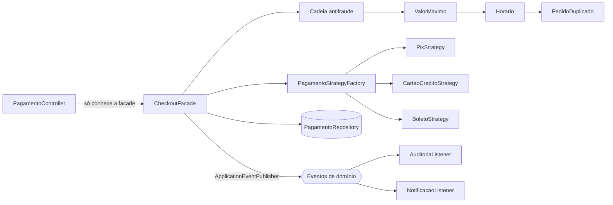
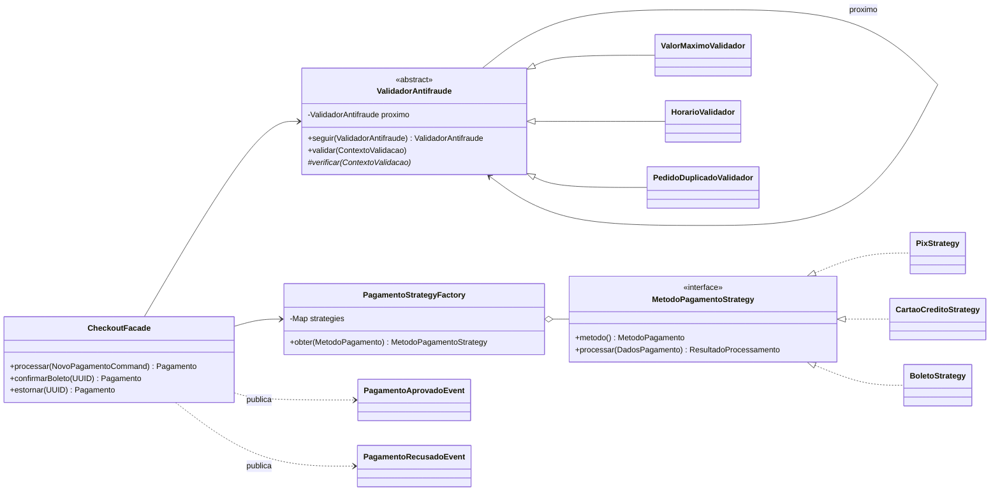
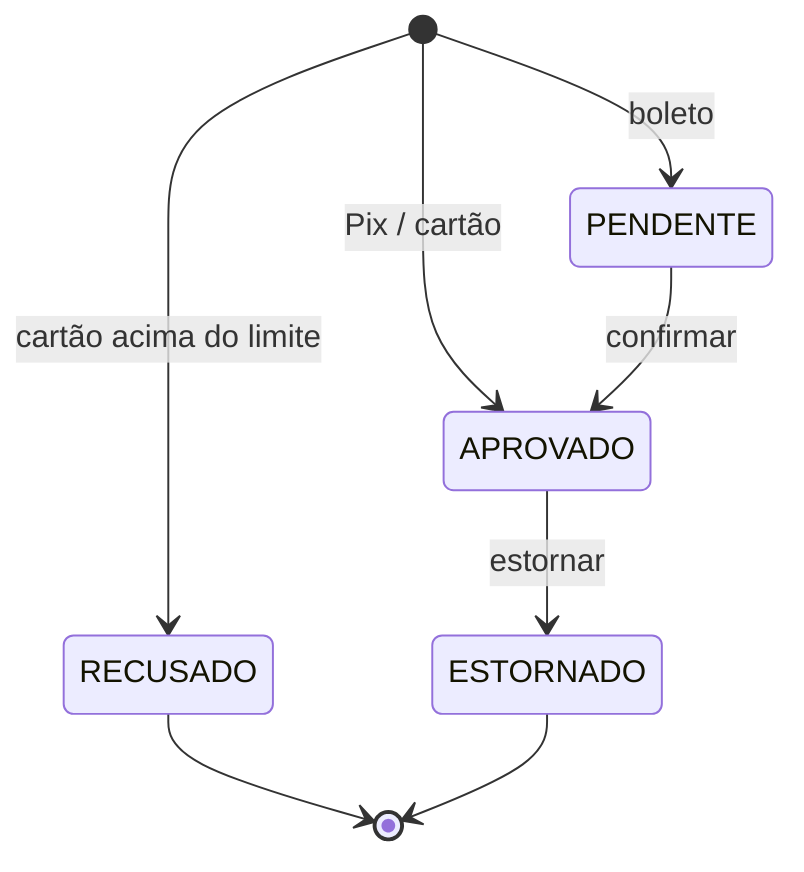

# payment-patterns-api

[](https://github.com/MatheusAnsel/payment-patterns-api/actions/workflows/ci.yml)

API REST de pagamentos de pedidos feita com Spring Boot. Aceita Pix, cartão de crédito e boleto, e cada método tem suas próprias regras de taxa, parcelamento e aprovação.

O projeto nasceu do desafio "Explorando Padrões de Projetos na Prática com Java", do Bootcamp Itaú Java com Inteligência Artificial (DIO). A proposta aqui foi usar os padrões para resolver problemas que o domínio de pagamentos realmente tem, e não apenas criar exemplos isolados de cada um.

## Sumário

- [Padrões de projeto](#padrões-de-projeto)
- [Regras de negócio](#regras-de-negócio)
- [Como rodar](#como-rodar)
- [Endpoints](#endpoints)
- [Exemplos de requisição](#exemplos-de-requisição)
- [Erros](#erros)
- [Testes](#testes)
- [Estrutura do projeto](#estrutura-do-projeto)
- [Decisões e limitações](#decisões-e-limitações)
- [Tecnologias](#tecnologias)

## Padrões de projeto

### Visão geral do fluxo de criação de um pagamento



### Relação entre as classes



### Onde cada padrão está e por quê

| Padrão | Onde | Problema que resolve |
|---|---|---|
| Strategy | `domain.strategy.MetodoPagamentoStrategy` e as implementações `PixStrategy`, `CartaoCreditoStrategy`, `BoletoStrategy` | Cada método calcula taxa, valida e decide o status inicial de um jeito diferente. Sem o padrão, isso viraria um bloco de `if/else` que cresce a cada método novo. Com ele, aceitar um método novo é criar uma classe, sem tocar nas existentes. |
| Factory | `domain.strategy.PagamentoStrategyFactory` | Escolhe a strategy pelo enum `MetodoPagamento`. O Spring injeta todas as implementações em uma `List`, e a factory monta um `EnumMap` uma única vez. Se faltar strategy para algum método ou houver duas para o mesmo, a aplicação nem sobe: o erro aparece no deploy, não no primeiro cliente que tentar pagar. |
| Facade | `application.CheckoutFacade` | O fluxo de pagamento envolve antifraude, strategy, persistência, transação e eventos. O controller fala apenas com a facade e não sabe que nada disso existe, o que deixa o controller fino e o fluxo testável sem HTTP. |
| Observer | `application.evento.*` publicados via `ApplicationEventPublisher`; `application.listener.AuditoriaListener` e `NotificacaoListener` | Auditoria e notificação são reações ao pagamento, não parte dele. A facade publica o evento e não conhece quem escuta. A auditoria usa `@EventListener` (roda dentro da transação); a notificação usa `@TransactionalEventListener`, que só dispara depois do commit, para não avisar o cliente de um pagamento que acabou não sendo gravado. |
| Singleton | Beans do Spring (todos os `@Component`, `@Service` e `@Configuration`) e `patterns.javapuro.GeradorProtocolo` | Veja a seção abaixo. |
| Chain of Responsibility (bônus) | `domain.validation.ValidadorAntifraude` e os elos `ValorMaximoValidador`, `HorarioValidador`, `PedidoDuplicadoValidador`; montagem em `infrastructure.config.AntifraudeConfig` | Cada regra antifraude é independente e pode ser incluída, removida ou reordenada sem afetar as outras. O primeiro elo que reprova interrompe a cadeia. As regras que rodam em memória vêm antes da que consulta o banco, então um pagamento barrado pelo valor não gera query. |

### Sobre o Singleton

No Spring, o escopo padrão de um bean é `singleton`: o container cria uma única instância por `ApplicationContext` e a injeta em todo lugar que precisar. É por isso que `CheckoutFacade`, as strategies e a factory existem uma vez só na aplicação, sem nenhuma linha de código extra. Esse é o jeito recomendado de ter um singleton em uma aplicação Spring, porque continua fácil trocar a implementação em testes.

Para mostrar o padrão sem o framework, o pacote `patterns.javapuro` tem a classe `GeradorProtocolo`, implementada com o idiom *initialization-on-demand holder*:

```java
public final class GeradorProtocolo {
    private GeradorProtocolo() { ... }

    private static final class Holder {
        private static final GeradorProtocolo INSTANCIA = new GeradorProtocolo();
    }

    public static GeradorProtocolo getInstancia() {
        return Holder.INSTANCIA;
    }
}
```

A JVM só carrega a classe `Holder` no primeiro acesso a `getInstancia()`, e o carregamento de classes é thread-safe por especificação. Isso garante inicialização preguiçosa e segura sem `synchronized` nem double-checked locking. O construtor também recusa uma segunda instância criada via reflection. O teste `GeradorProtocoloTest` dispara mil chamadas em 16 threads e confirma que existe uma única instância e que nenhum protocolo se repete.

## Regras de negócio

| Método | Taxa | Parcelas | Status inicial | Observações |
|---|---|---|---|---|
| Pix | sem taxa | apenas 1 | `APROVADO` | aprovação imediata |
| Cartão de crédito | 3,49% sobre o valor | 1 a 12 | `APROVADO` ou `RECUSADO` | até 3x sem juros; acima disso, juros de 1,99% a.m.; valores acima de R$ 10.000,00 são recusados |
| Boleto | R$ 2,50 fixo | apenas 1 | `PENDENTE` | vence em 3 dias úteis; vira `APROVADO` ao ser confirmado |

Detalhes do cálculo do cartão: a taxa é calculada sobre o valor e somada a ele. Acima de 3 parcelas, o total (valor + taxa) é financiado pela Tabela Price, com `PMT = PV * i / (1 - (1 + i)^-n)`. Exemplo: R$ 1.000,00 em 6x gera taxa de R$ 34,90, parcela de R$ 184,69 e total de R$ 1.108,14.

Antifraude, aplicado antes de qualquer processamento:

- valor acima de R$ 50.000,00 por transação é bloqueado;
- entre 00:00 e 05:59 (horário de Brasília), pagamentos acima de R$ 1.000,00 são bloqueados;
- não é permitido criar um pagamento para um pedido que já tem outro `PENDENTE` ou `APROVADO`. Pagamentos recusados ou estornados liberam o pedido para uma nova tentativa.

Transições de status:



Note a diferença entre recusa e bloqueio. Um pagamento recusado pelo cartão é gravado com status `RECUSADO` e gera evento, porque faz parte do histórico do pedido. Um pagamento barrado pelo antifraude ou com dados inconsistentes nem chega a ser gravado e a API responde 422.

## Como rodar

Pré-requisito: Java 21. O Maven vem pelo wrapper (`./mvnw`), não precisa estar instalado.

### Com Maven (perfil dev, banco H2 em memória)

```bash
./mvnw spring-boot:run
```

- API: http://localhost:8080/api/pagamentos
- Swagger UI: http://localhost:8080/swagger-ui.html
- Console do H2: http://localhost:8080/h2-console (JDBC URL `jdbc:h2:mem:pagamentos`, usuário `sa`, sem senha)

### Com Docker (perfil prod, PostgreSQL)

```bash
docker compose up --build
```

Sobe um PostgreSQL 16 e a API na porta 8080. O schema é criado pelo Flyway na inicialização.

Para rodar o jar em produção apontando para outro banco, ative o perfil `prod` e informe as variáveis:

| Variável | Descrição |
|---|---|
| `SPRING_PROFILES_ACTIVE` | `prod` |
| `DB_URL` | ex.: `jdbc:postgresql://host:5432/pagamentos` |
| `DB_USERNAME` | usuário do banco |
| `DB_PASSWORD` | senha do banco |
| `DB_POOL_SIZE` | opcional, padrão 10 |

## Endpoints

| Método | Caminho | Descrição |
|---|---|---|
| `POST` | `/api/pagamentos` | Cria e processa um pagamento. Responde 201 com header `Location`. |
| `GET` | `/api/pagamentos/{id}` | Busca um pagamento. |
| `GET` | `/api/pagamentos?status=&metodo=&page=&size=&sort=` | Lista com filtros opcionais e paginação (padrão: 20 por página, mais recentes primeiro, máximo de 100). |
| `POST` | `/api/pagamentos/{id}/confirmar` | Confirma um boleto pendente. |
| `POST` | `/api/pagamentos/{id}/estornar` | Estorna um pagamento aprovado. |

Corpo do `POST /api/pagamentos`:

| Campo | Tipo | Obrigatório | Regras |
|---|---|---|---|
| `pedidoId` | string | sim | até 64 caracteres |
| `valor` | número | sim | maior que zero, até 2 casas decimais |
| `metodo` | string | sim | `PIX`, `CARTAO_CREDITO` ou `BOLETO` |
| `parcelas` | inteiro | não | 1 a 12, apenas para cartão |

A entidade JPA nunca é exposta: entrada e saída usam records (`CriarPagamentoRequest`, `PagamentoResponse`, `PaginaResponse`).

## Exemplos de requisição

Pix:

```bash
curl -i -X POST http://localhost:8080/api/pagamentos \
  -H "Content-Type: application/json" \
  -d '{"pedidoId": "PED-1001", "valor": 199.90, "metodo": "PIX"}'
```

Cartão de crédito em 6x:

```bash
curl -X POST http://localhost:8080/api/pagamentos \
  -H "Content-Type: application/json" \
  -d '{"pedidoId": "PED-1002", "valor": 1000.00, "metodo": "CARTAO_CREDITO", "parcelas": 6}'
```

```json
{
  "id": "0b8f6f0e-3f4a-4d8e-9a57-6c0f1f2b9a11",
  "pedidoId": "PED-1002",
  "valor": 1000.00,
  "metodo": "CARTAO_CREDITO",
  "status": "APROVADO",
  "taxa": 34.90,
  "valorFinal": 1108.14,
  "parcelas": 6,
  "valorParcela": 184.69,
  "criadoEm": "2026-11-21T17:19:06.469826Z",
  "atualizadoEm": "2026-11-21T17:19:06.469826Z"
}
```

Boleto e confirmação:

```bash
curl -X POST http://localhost:8080/api/pagamentos \
  -H "Content-Type: application/json" \
  -d '{"pedidoId": "PED-1003", "valor": 300.00, "metodo": "BOLETO"}'
```

```bash
curl -X POST http://localhost:8080/api/pagamentos/{id}/confirmar
```

Estorno:

```bash
curl -X POST http://localhost:8080/api/pagamentos/{id}/estornar
```

Consulta e listagem:

```bash
curl http://localhost:8080/api/pagamentos/{id}
```

```bash
curl "http://localhost:8080/api/pagamentos?status=APROVADO&metodo=PIX&page=0&size=10"
```

## Erros

Todas as respostas de erro seguem a [RFC 7807](https://www.rfc-editor.org/rfc/rfc7807) (`application/problem+json`).

| Status | Quando |
|---|---|
| 400 | JSON malformado, campo obrigatório ausente, valor menor ou igual a zero, enum ou UUID inválido |
| 404 | pagamento não encontrado |
| 409 | duas requisições alteraram o mesmo pagamento ao mesmo tempo (lock otimista com `@Version`) |
| 422 | requisição válida que viola regra de negócio: parcelamento em Pix, confirmar algo que não é boleto, estornar algo não aprovado, bloqueio do antifraude |

Exemplo de bloqueio do antifraude:

```json
{
  "type": "https://payment-patterns-api/erros/pagamento-bloqueado",
  "title": "Pagamento bloqueado pelo antifraude",
  "status": 422,
  "detail": "Valor acima do máximo permitido por transação (R$ 50.000,00)",
  "instance": "/api/pagamentos",
  "regra": "VALOR_MAXIMO"
}
```

Exemplo de validação de campos:

```json
{
  "type": "https://payment-patterns-api/erros/validacao",
  "title": "Dados inválidos",
  "status": 400,
  "detail": "Um ou mais campos estão inválidos",
  "instance": "/api/pagamentos",
  "campos": {
    "valor": "deve ser maior que 0",
    "metodo": "não deve ser nulo"
  }
}
```

## Testes

```bash
./mvnw test
```

São 72 testes, todos rodando no `./mvnw test`:

- `PixStrategyTest`, `CartaoCreditoStrategyTest`, `BoletoStrategyTest`: taxas, arredondamento, limites, parcelamento e vencimento em dias úteis. Os valores esperados da Tabela Price foram calculados de forma independente, fora do código testado.
- `PagamentoStrategyFactoryTest`: resolução de cada método e falha na inicialização com strategy faltando ou duplicada.
- `CadeiaAntifraudeTest`: cada regra, limites exatos e a interrupção da cadeia no primeiro elo que reprova.
- `PagamentoTest`: transições de status permitidas e proibidas.
- `CheckoutFacadeTest`: orquestração com mocks, incluindo quais eventos são publicados em cada caso.
- `GeradorProtocoloTest`: instância única, concorrência e proteção contra reflection.
- `PagamentoControllerIntegrationTest`: todos os endpoints com MockMvc e banco H2, incluindo formato dos erros, filtros, paginação e eventos publicados.

Regras que dependem de data e hora (vencimento do boleto e antifraude por horário) recebem um `java.time.Clock` injetado, então os testes usam um relógio fixo e não quebram dependendo de quando rodam.

O GitHub Actions executa `./mvnw verify` em todo push e pull request.

## Estrutura do projeto

```
src/main/java/com/matheusansel/payments
├── api                     controller, DTOs e tratamento de erros
│   ├── dto
│   └── handler
├── application             CheckoutFacade, comando de entrada
│   ├── evento              eventos de domínio
│   └── listener            auditoria e notificação
├── domain                  entidade Pagamento, enums, exceções
│   ├── exception
│   ├── strategy            strategies e factory
│   └── validation          cadeia antifraude
├── infrastructure
│   ├── config              Clock, montagem da cadeia, OpenAPI
│   └── repository          Spring Data JPA e filtros
└── patterns
    └── javapuro            Singleton sem Spring
```

## Decisões e limitações

- Valores monetários usam `BigDecimal` com 2 casas e arredondamento `HALF_UP`, centralizados na classe `Dinheiro`.
- O schema é versionado com Flyway e o Hibernate apenas valida (`ddl-auto: validate`), nos dois perfis. O mesmo script roda no H2 (em modo PostgreSQL) e no PostgreSQL.
- A regra de pedido duplicado é verificada por consulta antes da gravação. Duas requisições simultâneas para o mesmo pedido ainda podem passar juntas. Em produção isso seria resolvido com um índice único parcial no PostgreSQL (`WHERE status IN ('PENDENTE', 'APROVADO')`) ou com uma chave de idempotência no header da requisição.
- Dias úteis do boleto consideram apenas fins de semana. Feriados nacionais ficariam em uma tabela ou serviço de calendário.
- A notificação é simulada com log. Em um sistema real, o listener publicaria em uma fila ou chamaria um serviço de e-mail.
- Não há autenticação, já que o foco do projeto são os padrões de projeto.

## Tecnologias

- Java 21
- Spring Boot 3.5 (Web, Data JPA, Validation, Actuator)
- Flyway
- H2 (dev) e PostgreSQL 16 (prod)
- springdoc-openapi (Swagger UI)
- JUnit 5, Mockito, AssertJ e MockMvc
- Docker e Docker Compose
- GitHub Actions

## Referências

- [lab-padroes-projeto-java](https://github.com/digitalinnovationone/lab-padroes-projeto-java) (DIO)
- [lab-padroes-projeto-spring](https://github.com/digitalinnovationone/lab-padroes-projeto-spring) (DIO)
